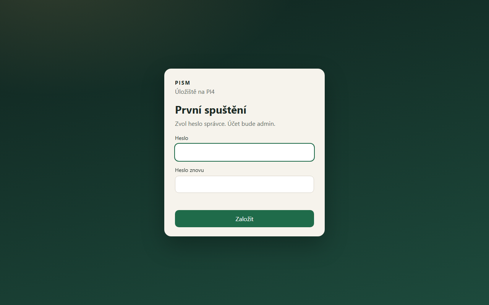
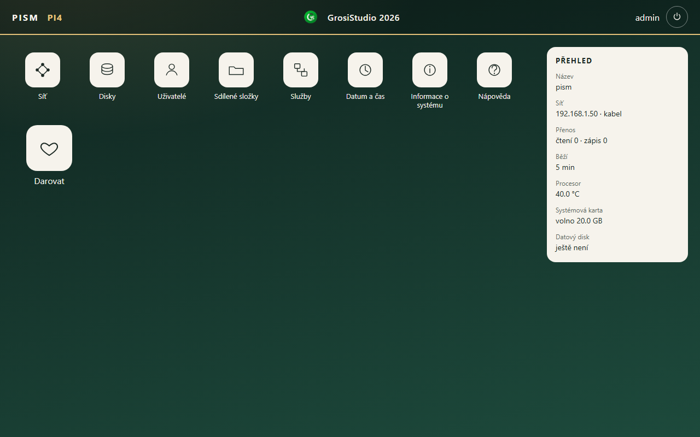
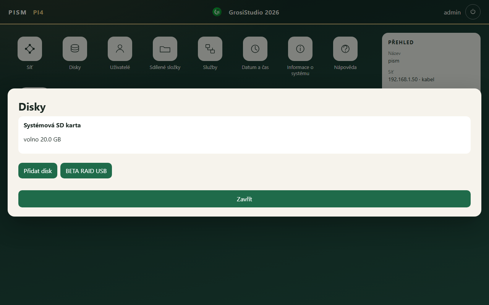
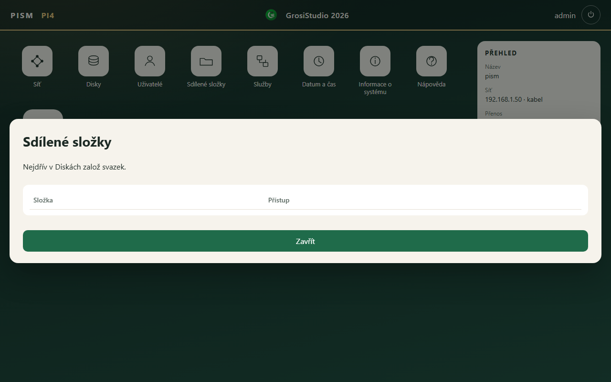

# PISM

**Aktuální verze 1.2, vystavená 31. 10. 2026.**

PISM je nadstavba pro debian linux LITE jak verzi ARM tak verzi 64bit x86.

Chtěl jsem něco co bude snadno nastavitelné jako NAS

Sdílené složky, účty, disky a zrcadlo se ovládají v prohlížeči.

PISM je pod licencí GrosiStudia. Další vývoj můžeš podpořit příspěvkem na PayPal grossmann@7ruzi.cz. Hodí se třeba 200 Kč, potěší i méně. Nic se tím neodemkne.

Po instalaci je úplně prázdné. Nejsou v něm účty, sdílené složky ani připojené disky.

V prohlížeči se otevře adresa IP kde zařízení leží. Je to běžné http, port 80. Za adresu se číslo portu nepíše, třeba http://192.168.1.50. Instalační věta tu adresu na konci vypíše.

První otevření si řekne o heslo správce. Účet bude admin.

Na desku ARM nebo pc X86-64  se nejdřív připraví Debian LITE a zapojí se internet. V příkazovém řádku se napíše jen tahle věta. Žádný soubor se tam nekopíruje.

```
curl -fsSL https://raw.githubusercontent.com/grosiln/pism/main/instaluj.sh | sudo bash
```

Soubor [instaluj.sh](instaluj.sh) je tu k nahlédnutí.

Když později vyjde novější verze, na ploše správce přibude ikona Aktualizace PISM. Účty, složky, disky, zrcadlo i síť zůstanou.

## První spuštění

Zvolí se heslo správce. Nic jiného v PISM ještě není.



## Plocha

Až heslo vznikne, otevře se plocha. Datový disk ještě není.



## Disky

Systémová karta je jen ta, na které běží systém. Připojený disk tam není. Přidá se až později, v Diskách.



## Sdílené složky

Složka jde založit až ve chvíli, kdy je datový disk.



---

**Current version 1.2, released 31 October 2026.**

PISM is an add-on for Debian Linux LITE, available for both ARM and 64-bit x86 architectures.

I wanted something that could be easily configured as a NAS.

Shared folders, user accounts, drives, and mirroring (RAID 1) are managed via a web browser.

PISM is licensed under GrosiStudia. You can support further development via a PayPal contribution to grossmann@7ruzi.cz. A donation of around 200 CZK is appreciated, though any amount is welcome. Please note that this does not unlock any additional features.

After installation, the system is completely empty—it contains no user accounts, shared folders, or mounted drives.

Access the system by entering the device's IP address into your web browser. It uses standard HTTP on port 80 (e.g., http://192.168.1.50). You do not need to specify the port number in the URL. The installation command will display the correct address upon completion.

When you first access the interface, you will be prompted to set an administrator password. The default username is "admin."

First, set up Debian LITE on an ARM board or an x86-64 PC and connect it to the internet. Then, simply enter this single sentence into the command line. No files need to be copied over.
```
curl -fsSL https://raw.githubusercontent.com/grosiln/pism/main/instaluj.sh | sudo bash
```

The file [instaluj.sh](instaluj.sh) is here to read.

When a newer version comes out later, a PISM update icon appears on the administrator desktop. Accounts, folders, disks, the mirror and the network stay.

## First start

The administrator password is chosen. Nothing else is in PISM yet.


## Desktop

Once the password exists, the desktop opens. There is no data disk yet.


## Disks

The system card is only the one the system runs on. A connected disk is not there. It is added later, in Disks.


## Shared folders

A folder can be created only once there is a data disk.


