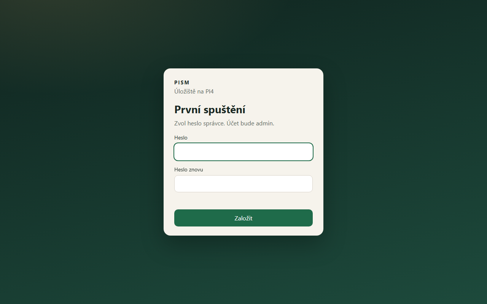
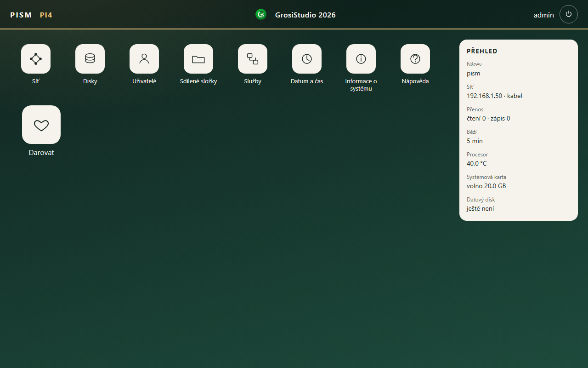
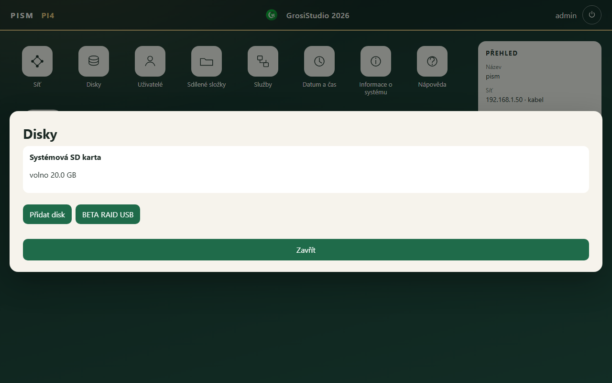
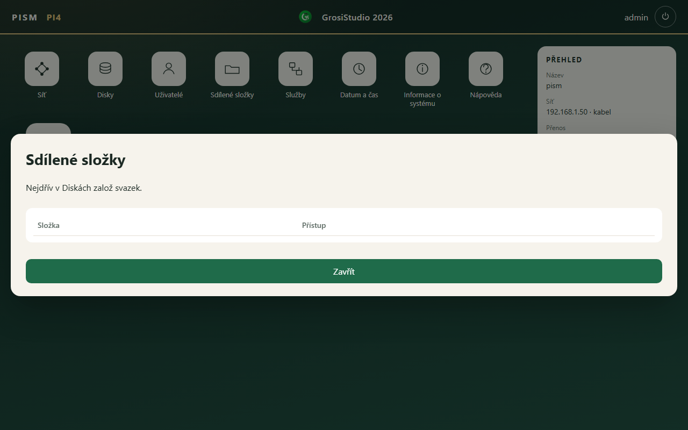

# PISM

**Aktuální verze 1.1, vystavená 23. 10. 2026.**

PISM je úložiště na Raspberry Pi 4. Sdílené složky, účty, disky a zrcadlo se ovládají v prohlížeči.

PISM je pod licencí GrosiStudia. Další vývoj můžeš podpořit příspěvkem na PayPal grossmann@7ruzi.cz. Hodí se třeba 200 Kč, potěší i méně. Nic se tím neodemkne.

Po instalaci je úplně prázdné. Nejsou v něm účty, sdílené složky ani připojené disky.

V prohlížeči se otevře adresa toho PI4. Je to běžné http, port 80. Za adresu se číslo portu nepíše, třeba http://192.168.1.50. Instalační věta tu adresu na konci vypíše. První otevření si řekne o heslo správce. Účet bude admin.

Na nové PI4 se nejdřív připraví běžný Raspberry Pi OS a zapojí se internet. V příkazovém řádku se napíše jen tahle věta. Žádný soubor se tam nekopíruje.

```
curl -fsSL https://raw.githubusercontent.com/grosiln/pism/main/instaluj.sh | sudo bash
```

Soubor [instaluj.sh](instaluj.sh) je tu k nahlédnutí.

Když později vyjde novější verze, na ploše správce přibude ikona Aktualizace PISM. Účty, složky, disky, zrcadlo i síť zůstanou.

## První spuštění

Zvolí se heslo správce. Nic jiného v PISM ještě není.



## Plocha

Až heslo vznikne, otevře se plocha. Datový disk ještě není.



## Disky

Systémová karta je jen ta, na které běží systém. Připojený disk tam není. Přidá se až později, v Diskách.



## Sdílené složky

Složka jde založit až ve chvíli, kdy je datový disk.


