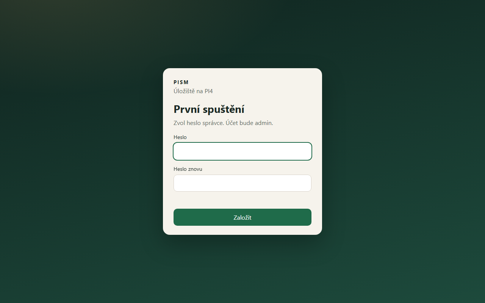
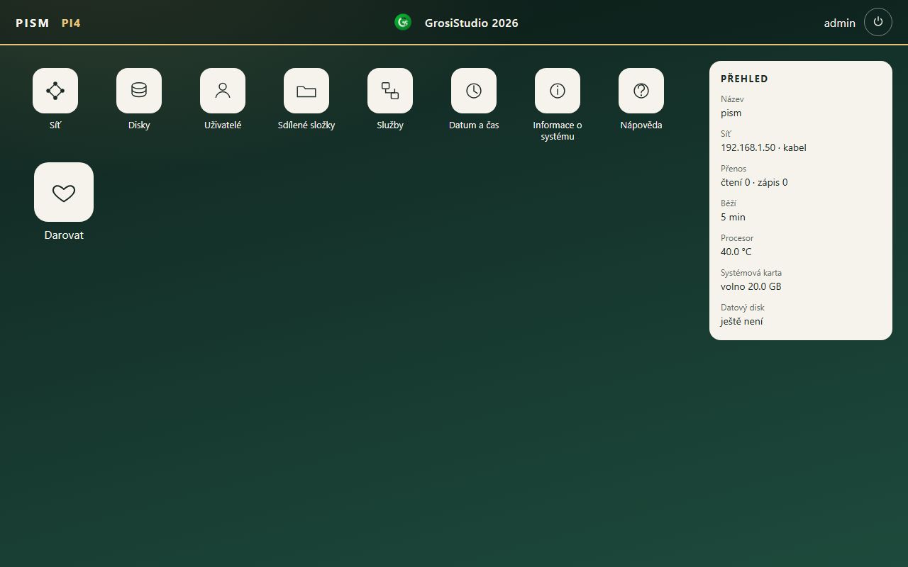
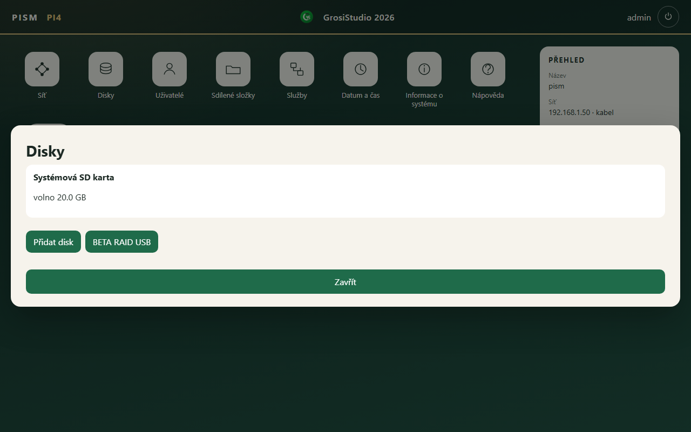
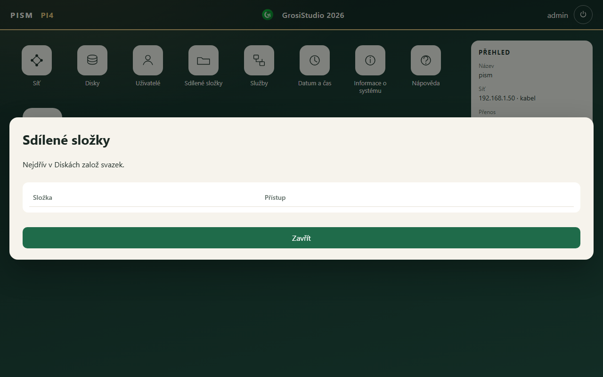

# PISM

**Aktuální verze 1.2, vystavená 31. 10. 2026.**

PISM je úložiště na Raspberry Pi 4. Sdílené složky, účty, disky a zrcadlo se ovládají v prohlížeči.

PISM je pod licencí GrosiStudia. Další vývoj můžeš podpořit příspěvkem na PayPal grossmann@7ruzi.cz. Hodí se třeba 200 Kč, potěší i méně. Nic se tím neodemkne.

Po instalaci je úplně prázdné. Nejsou v něm účty, sdílené složky ani připojené disky.

V prohlížeči se otevře adresa toho PI4. Je to běžné http, port 80. Za adresu se číslo portu nepíše, třeba http://192.168.1.50. Instalační věta tu adresu na konci vypíše. První otevření si řekne o heslo správce. Účet bude admin.

Na nové PI4 se nejdřív připraví běžný Raspberry Pi OS a zapojí se internet. V příkazovém řádku se napíše jen tahle věta. Žádný soubor se tam nekopíruje.

```
curl -fsSL https://raw.githubusercontent.com/grosiln/pism/main/instaluj.sh | sudo bash
```

Soubor [instaluj.sh](instaluj.sh) je tu k nahlédnutí.

Když později vyjde novější verze, na ploše správce přibude ikona Aktualizace PISM. Účty, složky, disky, zrcadlo i síť zůstanou.

## První spuštění

Zvolí se heslo správce. Nic jiného v PISM ještě není.



## Plocha

Až heslo vznikne, otevře se plocha. Datový disk ještě není.



## Disky

Systémová karta je jen ta, na které běží systém. Připojený disk tam není. Přidá se až později, v Diskách.



## Sdílené složky

Složka jde založit až ve chvíli, kdy je datový disk.



---

**Current version 1.2, released 31 October 2026.**

PISM is storage on a Raspberry Pi 4. Shared folders, accounts, disks and a mirror are controlled in the browser.

PISM is under the GrosiStudio licence. Further work can be supported with a gift to PayPal grossmann@7ruzi.cz. Something like 200 Kč fits, and less is welcome too. Nothing is unlocked by it.

After installation it is completely empty. There are no accounts, no shared folders and no connected disks.

The browser opens the address of that PI4. It is ordinary http, port 80. The port number is not written after the address, for example http://192.168.1.50. The install sentence prints that address at the end. The first open asks for the administrator password. The account will be admin.

On a new PI4, ordinary Raspberry Pi OS is prepared first and the internet is connected. Only this sentence is typed in the command line. No file is copied there.

```
curl -fsSL https://raw.githubusercontent.com/grosiln/pism/main/instaluj.sh | sudo bash
```

The file [instaluj.sh](instaluj.sh) is here to read.

When a newer version comes out later, a PISM update icon appears on the administrator desktop. Accounts, folders, disks, the mirror and the network stay.

## First start

The administrator password is chosen. Nothing else is in PISM yet.


## Desktop

Once the password exists, the desktop opens. There is no data disk yet.


## Disks

The system card is only the one the system runs on. A connected disk is not there. It is added later, in Disks.


## Shared folders

A folder can be created only once there is a data disk.


